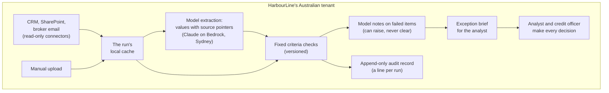

# Production note

## Target architecture and data flow

Built: the versioned criteria checks, the model wrapper (replayed by default, one live run kept) and the audit
record. Mocked: the sources and the document parser's output; no parser is built. Proposed: read-only connectors,
a document parser per document type (built by us, on a bought OCR service such as Amazon Textract), Claude on Bedrock
in Sydney.

## Identity, access, privacy and audit controls

Personal data stays in the Australian tenant; the tool is read-only; analysts sign in through HarbourLine's identity
provider; each run records its model, sources and rule versions. Before the pilot: a security review (OAuth/OIDC,
tokenising personal data).

## Evaluation dataset and acceptance criteria

Past applications, agreed with privacy, each with the result an experienced analyst expects. Accept at 95%
mandatory-evidence extraction, every statement traced to its source, nothing unchecked shown as satisfied. Rerun
before any model or rule change. At 88% pilot accuracy: stay side by side, send the weak fields to "please check",
and grow the evaluation set until 95%.

## Model and system failure modes, and safe fallback

- Model down or not allowed: fixed checks still run; document items read "unable to verify".
- A source down or delayed a week: "unable to verify", never missing; uploads are still read.
- A model quote not found in its source: "unable to verify" ("please check").
- Each layer passes up the error it has (an unreadable document stays "unable to verify", saying why); a layer with
  no answer from below reports it unavailable; a top-level classifier turns the rest into a plain system error.

## Pilot, human review and rollout sequence

Pilot analysts run it beside their usual process, then brief from it, then the group widens. Analysts review every
item; credit officers make every decision. Their engineer (four hours a week) grants access.

## Monitoring, incident response and rollback

Watch preparation time, weekly use and "unable to verify" rates. An error found after use: recheck every application
it touched and add the case to the evaluation set. Rollback: model off in config.

## Analyst adoption and feedback loop

A staged rollout: start with a small group of analysts and the steps they find most painful. Findings they mark wrong
are reviewed weekly and join the evaluation set. Expand to more analysts only once that group are advocates for it.

## Build, buy or reuse

Buy or reuse the model, identity, CRM and SharePoint. Build the criteria checks, the brief and the document parsers:
HarbourLine has none today, so each document type gets its own parser, built on a bought OCR and layout service (for
example Amazon Textract) rather than from scratch.
