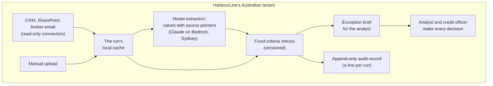

# Production note

## Target architecture and data flow

| Part | In the prototype | In production |
|---|---|---|
| CRM, SharePoint, broker email | Mocked: folders of generated files (`sharepoint/`, `applications/`), pulled into `cache/` | Read-only connectors into HarbourLine's systems |
| Document parser | None built: ready-made parser output beside each PDF | One parser per document type, each matching its source's API (for example Amazon Textract) |
| Lending criteria | Built: `checklist/criteria.py`, invented rules, versioned | HarbourLine's rules, owned by credit policy |
| Model | Built: Claude through the Anthropic API, behind `checklist/model.py`; by default, saved responses replayed | Claude on Amazon Bedrock in Sydney: a small provider added to the wrapper, then set in config |
| Audit record | Built: a line per run in `audit/` | An append-only store in the tenant |

## Identity, access, privacy and audit controls

Personal data stays in the Australian tenant, and the tool is read-only. Analysts sign in through HarbourLine's
identity provider. Every run records the model, sources and rule versions used. Before the pilot: a security review
of access (OAuth/OIDC) and tokenising or hashing personal data.

## Evaluation dataset and acceptance criteria

Past HarbourLine applications, agreed with privacy, each with the result an experienced analyst expects. Accept at
95% or better mandatory-evidence extraction, every statement traced to its source, and nothing unchecked shown as
satisfied. Rerun before any model or rule change; add every error found in use.

## Model and system failure modes, and safe fallback

- Model down or not allowed: the fixed checks still run; document items read "unable to verify" with links.
- A source down: its items read "unable to verify", never missing; a manual upload is still read.
- Each layer passes up the error it has (an unreadable document stays "unable to verify", saying why); a layer with
  no answer from the one below reports it unavailable; a top-level classifier turns the rest into a plain system error.
- The model can raise a concern on an item, but never clear one.

## Pilot, human review and rollout sequence

Pilot analysts first run the tool beside their usual process, then prepare briefs from it, then the group widens.
The analyst reviews every item; the credit officer makes every decision. HarbourLine's engineer (about four hours a
week) grants the connectors' access; the pod builds the rest.

## Monitoring, incident response and rollback

Watch preparation time, weekly use and "unable to verify" rates. An error found after use is a recall: HarbourLine's
process for analyst mistakes covers every application it touched; fix it and add the case to the evaluation set.
Rollback: switch the model off or change it in config.

## Analyst adoption and feedback loop

Start with the steps analysts find most painful. Findings analysts mark wrong are reviewed weekly and join the
evaluation set. Target: 70% weekly use. Tell analysts plainly when something is paused.

## Build, buy or reuse

Buy or reuse the model, document parsers, identity, CRM and SharePoint; build only the criteria checks and brief.

## Next steps, not built here

An evaluation rerun command; CRM updates drafted for the analyst to accept; more fields arriving structured, so more
items are checked with the model off.
